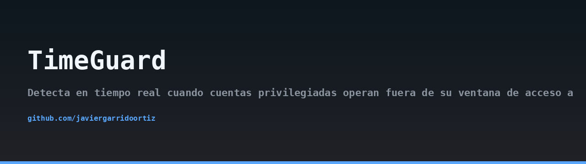
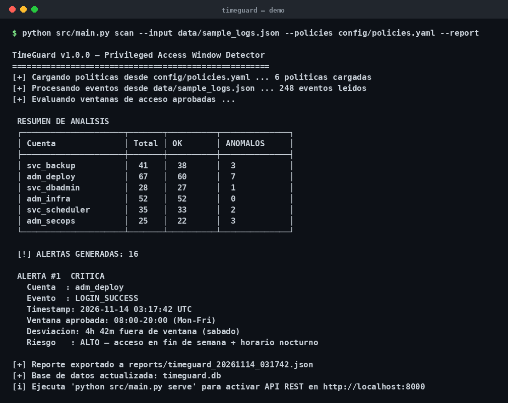

## Demo



> 🇪🇸 Read this in [Spanish](README.md).

# TimeGuard

Real-time detection of privileged accounts operating outside their approved access window. An ITDR (Identity Threat Detection and Response) tool based on temporal analysis.

## The problem

Most identity attacks do not steal credentials through sophisticated exploits. They use valid accounts at the wrong time. A domain administrator logging in at 03:14 on a Sunday, a service account active during a public holiday, a database operator connecting from an unexpected timezone. Traditional SIEM rules focus on volume and known signatures; they rarely model the *legitimate temporal behavior* of each privileged identity.

TimeGuard addresses this gap: it defines an approved access window per account (or per role/group), evaluates every authentication event against that window, and produces a risk score that combines the magnitude of the deviation with the context (night, weekend, holiday, combinations).

## Why ITDR

Identity Threat Detection and Response is the discipline that assumes the perimeter has already been crossed and focuses on detecting abuse of valid identities. Temporal anomalies are one of the highest signal-to-noise indicators available: they require no endpoint agent, no network sensor, and no decryption. Just logs and a policy.

## Architecture

Five modules orchestrated from a CLI entry point:

- **ingestor** — accepts JSON or CSV access logs, optionally from the bundled mock HTTP server, and normalizes each event into a Pydantic model with `account`, `event_type`, `timestamp` (UTC), `source_ip`, and `session_id`.
- **parser** — derives temporal metadata: weekday, local hour adjusted by the account timezone, and whether the timestamp falls on a configured holiday.
- **policy_engine** — loads a YAML file with policies per account or per role/group: approved time window, allowed days, reference timezone, and risk level. Resolves group inheritance over individual account settings.
- **detector** — receives events flagged as out-of-window, computes the deviation in minutes, the risk context (night, weekend, holiday, combinations), and a numeric score from 0 to 100.
- **storage** — persists alerts in SQLite via SQLAlchemy Core.
- **alerter** — two outputs: colored Rich tables in the CLI and a FastAPI REST API.

APScheduler runs the scan periodically in daemon mode.

## Installation

```bash
python3.11 -m venv .venv
source .venv/bin/activate
pip install -r requirements.txt
```

## CLI usage

Scan logs once and print alerts:

```bash
python -m src.main scan --logs data/sample_logs.json --policies config/policies.yaml
```

Start the REST API and the scheduled scanner:

```bash
python -m src.main serve --host 0.0.0.0 --port 8000 --interval 300
```

Generate a summary report from the database:

```bash
python -m src.main report --since 2024-01-01 --severity high
```

All configuration values (database path, log source, schedule interval) can be overridden through environment variables or CLI flags. No secrets are stored in the repository.

## policies.yaml format

```yaml
holidays:
  - 2024-01-01
  - 2024-12-25

groups:
  admins:
    window: "08:00-20:00"
    days: [Mon, Tue, Wed, Thu, Fri]
    timezone: Europe/Madrid
    risk: high

accounts:
  svc_backup:
    window: "02:00-04:00"
    days: [Mon, Tue, Wed, Thu, Fri, Sat, Sun]
    timezone: UTC
    risk: medium
```

Account-level settings override group settings. If an account has no explicit policy and belongs to a group, the group policy applies.

## Log input formats

JSON array of events:

```json
[
  {"account": "admin1", "event_type": "login", "timestamp": "2024-03-10T03:14:00Z", "source_ip": "10.0.0.5", "session_id": "abc123"}
]
```

CSV with header row:

```csv
account,event_type,timestamp,source_ip,session_id
admin1,login,2024-03-10T03:14:00Z,10.0.0.5,abc123
```

Timestamps must be ISO 8601 in UTC. The ingestor rejects malformed entries and logs them without aborting the batch.

## REST API

- `GET /api/v1/alerts` — list alerts, filterable by `severity`, `account`, and `since`.
- `GET /api/v1/stats` — aggregated counts per severity, account, and risk context.
- `POST /api/v1/scan` — trigger an on-demand scan against the configured log source.

All endpoints return JSON. Authentication is delegated to the reverse proxy in front of the service.

## MITRE ATT&CK mapping

Out-of-window privileged activity maps primarily to **T1078 — Valid Accounts**, including sub-techniques T1078.002 (Domain Accounts) and T1078.004 (Cloud Accounts). The temporal signal complements detections based on impossible travel, MFA fatigue, and credential dumping.

## Sample data and mock server

`data/sample_logs.json` contains synthetic events covering night logins, weekend activity, and holiday access. `src/mock_server.py` exposes the same data over HTTP for end-to-end testing:

```bash
python -m src.mock_server --port 8090
python -m src.main scan --logs http://localhost:8090/logs --policies config/policies.yaml
```

Tests use these synthetic fixtures to remain reproducible without external infrastructure.

## Known limitations

- Holiday tables are static and must be maintained per region.
- The detector assumes a single reference timezone per account; multi-region identities need explicit policy entries.
- No baseline learning yet: windows are declared, not inferred.
- SQLite is sufficient for moderate volumes; high-throughput deployments should swap the storage layer.

## Roadmap

- Behavioral baselining to suggest windows from historical data.
- Native integrations with SIEM and SOAR platforms.
- Additional context signals: source ASN, geo-velocity, device fingerprint.
- Policy versioning and audit trail.

## License

MIT. See [LICENSE](LICENSE).

Author: Javier Garrido Ortiz.
