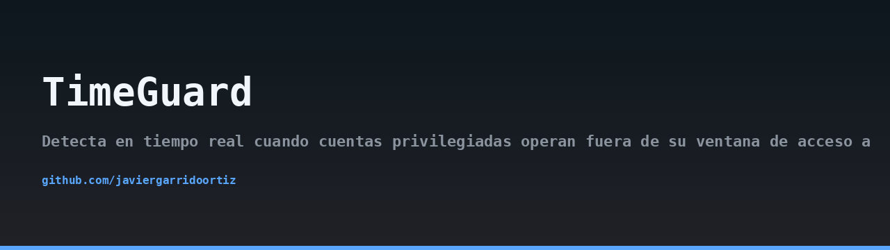
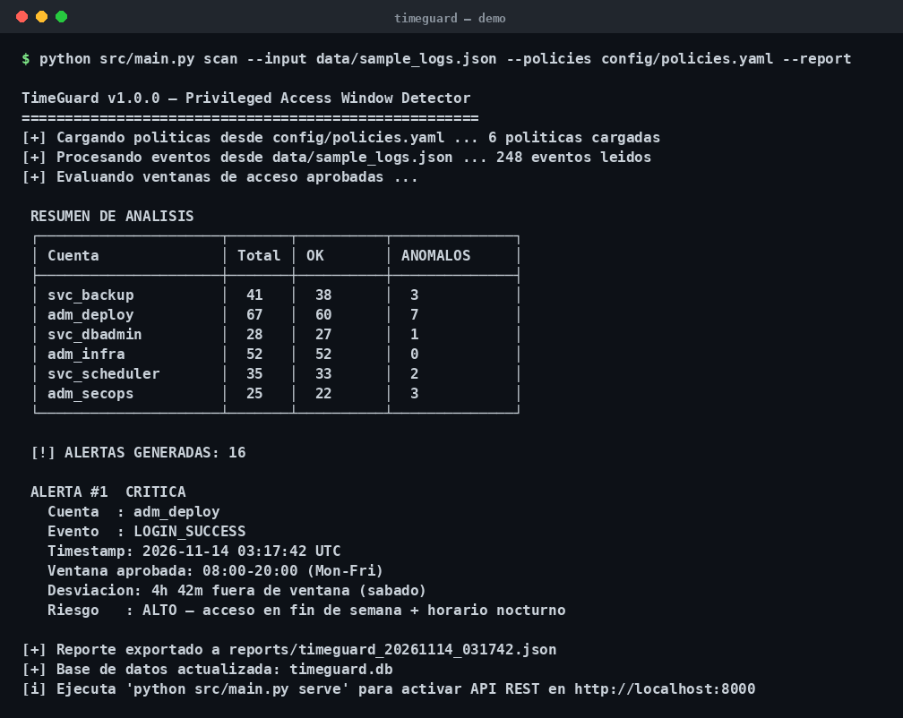
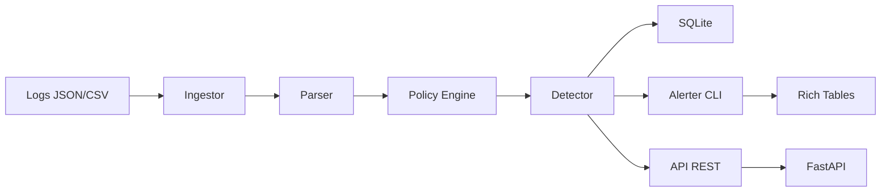

## Demo



# TimeGuard

> 🇬🇧 Read this in [English](README.en.md).

[](https://www.python.org/downloads/release/python-3110/)
[](https://fastapi.tiangolo.com/)
[](https://opensource.org/licenses/MIT)
[](https://attack.mitre.org/techniques/T1078/)

TimeGuard es una herramienta de detección y respuesta para amenazas internas (ITDR) que monitoriza en tiempo real las operaciones de cuentas privilegiadas y alerta cuando se producen fuera de su ventana de acceso aprobada. Basado en análisis temporal, ayuda a identificar uso indebido de credenciales legítimas (MITRE ATT&CK T1078).

## El problema

Las cuentas con privilegios elevados (administradores, cuentas de servicio, acceso a sistemas críticos) suelen tener horarios de trabajo definidos. Sin embargo, los sistemas tradicionales de gestión de identidades no siempre aplican restricciones horarias, y los equipos de seguridad carecen de visibilidad cuando estas cuentas se utilizan en momentos inusuales: de madrugada, en fin de semana o durante festivos. Este uso anómalo es una señal temprana de compromiso de credenciales, abuso interno o movimiento lateral.

TimeGuard cierra esta brecha analizando los logs de acceso y comparándolos con políticas horarias predefinidas, generando alertas priorizadas por riesgo.

## Motivación ITDR

ITDR (Identity Threat Detection and Response) se centra en proteger el plano de identidad. TimeGuard aporta una capa de detección basada en el comportamiento temporal, complementando soluciones de SIEM y EDR. Al correlacionar eventos de autenticación con ventanas de acceso y contextos de riesgo (nocturnidad, fines de semana, festivos), permite a los equipos de seguridad reaccionar ante posibles usos indebidos de cuentas privilegiadas.

## Arquitectura

TimeGuard se compone de cinco módulos principales orquestados desde una CLI:

- **Ingestor**: acepta logs en JSON o CSV, normaliza los eventos a un modelo Pydantic y opcionalmente consume de un mock server HTTP.
- **Parser**: extrae metadatos temporales (día de la semana, hora local ajustada por zona horaria, festivos).
- **Policy Engine**: carga políticas YAML por cuenta o rol/grupo, resuelve herencia y evalúa cada evento contra la ventana permitida.
- **Detector**: calcula la desviación en minutos, contexto de riesgo y un score 0-100. Persiste alertas en SQLite.
- **Alerter**: expone resultados por CLI (tablas Rich) y API REST (FastAPI).



## Instalación

Requiere Python 3.11 o superior.

```bash
pip install -r requirements.txt
```

## Uso CLI

TimeGuard ofrece tres comandos principales: `scan`, `serve` y `report`.

### scan

Procesa un fichero de logs y genera alertas.

```bash
python src/main.py scan --input data/sample_logs.json --policies config/policies.yaml
```

Opciones:
- `--input`: ruta al fichero de logs (JSON o CSV).
- `--policies`: ruta al fichero YAML de políticas.
- `--db`: ruta a la base de datos SQLite (por defecto `timeguard.db`).
- `--output`: formato de salida (`table` o `json`).

### serve

Inicia la API REST y el planificador para escaneos periódicos.

```bash
python src/main.py serve --host 0.0.0.0 --port 8000 --interval 300
```

Opciones:
- `--host`: dirección de escucha (por defecto `127.0.0.1`).
- `--port`: puerto (por defecto `8000`).
- `--interval`: intervalo en segundos entre escaneos automáticos (por defecto `300`).

### report

Muestra un resumen de alertas almacenadas.

```bash
python src/main.py report --db timeguard.db --severity high
```

Opciones:
- `--db`: ruta a la base de datos SQLite.
- `--severity`: filtra por severidad (`low`, `medium`, `high`, `critical`).
- `--limit`: número máximo de alertas a mostrar.

## Formato de políticas (`policies.yaml`)

El fichero YAML define políticas por rol/grupo y por cuenta individual. La herencia permite que una cuenta sobrescriba valores del grupo.

```yaml
# Ejemplo anotado
timezone: "Europe/Madrid"  # Zona horaria por defecto
holidays:  # Lista de festivos (formato YYYY-MM-DD)
  - "2025-01-01"
  - "2025-12-25"

groups:
  admins:
    allowed_hours: "08:00-20:00"  # Ventana horaria permitida
    allowed_days: ["Mon", "Tue", "Wed", "Thu", "Fri"]  # Días laborables
    risk_level: "high"

accounts:
  svc_backup:
    group: admins  # Hereda la política del grupo
    allowed_hours: "02:00-04:00"  # Sobrescribe la ventana para esta cuenta
    risk_level: "critical"
```

## Formato de logs de entrada

TimeGuard acepta logs en JSON (array de objetos) o CSV con cabecera. Campos requeridos:

- `account`: nombre de la cuenta.
- `event_type`: tipo de evento (ej. `login`, `sudo`, `access`).
- `timestamp`: marca temporal en UTC (ISO 8601).
- `source_ip`: dirección IP de origen.
- `session_id`: identificador de sesión (opcional).

Ejemplo JSON:
```json
[
  {
    "account": "admin1",
    "event_type": "login",
    "timestamp": "2025-03-15T02:30:00Z",
    "source_ip": "192.0.2.1",
    "session_id": "abc123"
  }
]
```

Ejemplo CSV:
```csv
account,event_type,timestamp,source_ip,session_id
admin1,login,2025-03-15T02:30:00Z,192.0.2.1,abc123
```

## API REST

La API expone los siguientes endpoints (prefijo `/api/v1`):

- `GET /alerts`: lista alertas, con filtros opcionales `severity`, `account`, `from`, `to`.
- `GET /stats`: estadísticas agregadas (total alertas, por severidad, por cuenta).
- `POST /scan`: inicia un escaneo bajo demanda; acepta un cuerpo JSON con la ruta al fichero de logs o datos embebidos.

Ejemplo de petición:
```bash
curl -X POST http://localhost:8000/api/v1/scan -H "Content-Type: application/json" -d '{"input_file": "data/sample_logs.json"}'
```

## Mapeo a MITRE ATT&CK T1078 (Valid Accounts)

La técnica T1078 describe el uso de credenciales legítimas para acceder a sistemas. TimeGuard detecta este comportamiento al identificar accesos fuera de la ventana horaria aprobada, que a menudo indican compromiso de cuentas. Al correlacionar con contexto de riesgo (nocturnidad, fines de semana, festivos) y generar alertas con score, ayuda a los equipos a priorizar investigaciones sobre posibles usos indebidos de cuentas válidas.

## Datos de ejemplo y mock server

El directorio `data/` contiene `sample_logs.json` con eventos sintéticos para pruebas. Además, se incluye un mock server (`src/mock_server.py`) que sirve logs de prueba vía HTTP para simular una fuente de datos. Para usarlo:

```bash
python src/mock_server.py --port 8080
```

Luego, en el ingestor, configure la URL del mock server mediante la variable de entorno `TIMEGUARD_MOCK_URL`.

## Limitaciones conocidas

- No realiza correlación con otras fuentes (SIEM, EDR).
- La tabla de festivos es estática y debe actualizarse manualmente.
- El análisis es batch; para tiempo real se requiere integración con streaming.
- No gestiona autenticación en la API (pensado para entornos controlados).

## Roadmap

- Integración con fuentes de logs en tiempo real (Kafka, syslog).
- Soporte para múltiples zonas horarias por cuenta.
- Dashboard web interactivo.
- Motor de reglas configurable con expresiones.
- Notificaciones por correo y webhook.

## Licencia

Este proyecto se distribuye bajo la licencia MIT. Consulte el fichero [LICENSE](LICENSE) para más detalles.